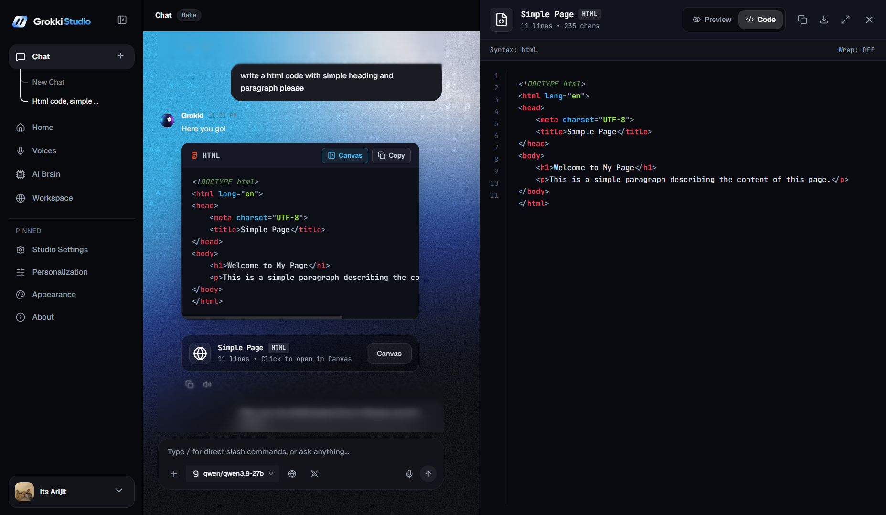
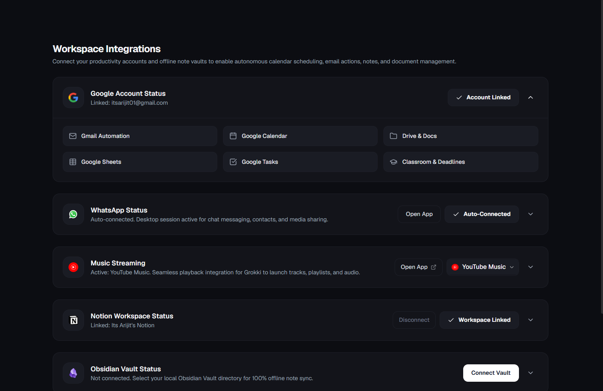

<div align="center">
  <br />
  <picture>
    <source media="(prefers-color-scheme: dark)" srcset="assets/grokki_wordmark.png">
    <source media="(prefers-color-scheme: light)" srcset="assets/grokki_wordmark_light.png">
    
  </picture>
  <br />
  <br />
  <h3>Autonomous AI desktop companion living in an Apple-style Dynamic Island.</h3>
  <p>Real-time desktop vision, physical OS mouse and keyboard automation, 65+ native Windows tools, and hybrid local/cloud intelligence.<br />Summoned instantly anywhere with Alt+Q.</p>
  <p>
    
    
    
    
    
  </p>
  <p>
    <a href="#features"><strong>Features</strong></a> ·
    <a href="#screenshots"><strong>Screenshots</strong></a> ·
    <a href="#ai-brain-engines"><strong>AI Brains</strong></a> ·
    <a href="#desktop-tool-arsenal"><strong>Tool Arsenal</strong></a> ·
    <a href="#installation"><strong>Installation</strong></a> ·
    <a href="#packaging"><strong>Packaging</strong></a>
  </p>
  <br />
</div>

<p align="center">
  
</p>

## Overview

Grokki is an autonomous Windows desktop agent designed to live directly at the top of your screen inside a glass Dynamic Island. Rather than existing as an isolated browser chatbot, Grokki has direct physical agency over your operating system: he sees your displays with low-token vision, executes multi-step plans across native applications, and physically drives your mouse and keyboard.

| Capability | Scope | What it does |
| :--- | ---: | :--- |
| **System & Desktop Agency** | 18 tools | Mouse tracking, keyboard injection, audio, window management, screen capture |
| **Workspace Integrations** | 22 tools | Google Workspace, Notion databases, local Obsidian vaults, GitHub CLI |
| **Productivity & Code** | 15 tools | Artifact sandbox canvas, VS Code bug diagnosis, file parsing, document authoring |
| **Media & Audio** | 10 tools | Spotify, YouTube Music, Apple Music controls, playlist search, lecture synthesis |
| **Multi-Brain & Grounding** | 9 engines | Dual-battle comparative runs, consensus synthesis, live web grounding |

---

## Features

### Genuine desktop blur
Windows cannot natively blur third-party desktop windows behind transparent frameless Electron surfaces. Grokki implements a dedicated GPU-accelerated capture pipeline:
* On summon (`Alt + Q`), the system snaps your desktop background in the background.
* Applies a hardware-accelerated Apple-spec Gaussian blur layer (`blur(38px) brightness(0.55) saturate(190%)`).
* Your wallpaper, active code editor, terminal, and browser blur dynamically behind the island in real time.
* Dismiss by clicking anywhere outside the interface.

### Physical mouse and keyboard automation
* Moves the actual Windows OS mouse cursor with smooth easing trajectories.
* Executes left-clicks, double-clicks, right-clicks, and keystrokes directly into active applications (Notepad, Word, File Explorer, Terminal).
* Includes safe boundaries and emergency abort shortcut (`Esc`).

### Ultra-low token screen vision
* Captures active displays and downscales frames for multimodal models.
* Cost per screen scan: ~250 tokens via Gemini Flash Vision.
* Diagnoses compile errors in VS Code, inspects software installation wizards, and reads documents on screen without manual uploads.

### Interactive artifacts and code canvas
* Sandboxed preview drawer (`w-[48%]` split pane) for live rendering of HTML, CSS, SVG, JavaScript, and Markdown.
* Integrated syntax-highlighted code editor with line numbers, 1-click clipboard copy, and direct save to workspace files.
* Adaptive layout that toggles between split view and full workspace mode.

### Multi-brain dual battle and consensus
* Dispatches any prompt concurrently to two separate AI brains (e.g. Gemini Flash vs. Groq Qwen/Llama or local Ollama).
* Comparative side-by-side card grid showing model name, individual latency in milliseconds, copy buttons, and winner selection.
* Interactive consensus engine cross-examines both model outputs, filters hallucinations, and synthesizes a unified verdict.

### Deep workspace project context (`@file` & `@folder`)
* Cursor-style inline context suggestion triggered by typing `@` anywhere in the chat input.
* Indexes local project files with fuzzy matching, file size indicators, and file type icons.
* Mentioning `@folder` recursively parses directories (filtering `node_modules`, `.git`, and build caches) to bundle source code directly into model context.

### Live web grounding and citations
* One-click deep search toggle formulated for real-time web retrieval.
* Queries live search engines and injects relevant source snippets before model generation.
* Displays an expandable Perplexity-style source accordion with domain badges, favicon previews, and hoverable inline citation tooltips (`[1]`, `[2]`).

### Autonomous goal execution and dynamic pivoting
* Zero hardcoded branching: Grokki formulates multi-step action plans dynamically.
* Example: Ask Grokki to *"Play The Weeknd on Spotify"*. Grokki checks if Spotify Desktop is running. If absent, he pivots to Spotify Web. If logged out, he halts, inspects your screen, and asks:
  > *"Spotify is not logged in on your browser. Would you like to log in now, or should I switch to YouTube Music instead?"*

### Highlight to action
* Highlight any text or code in your browser, PDF, or editor, and press **`Alt + Q`**.
* Ask Grokki to *"Rewrite this"*, *"Fix bugs in this selection"*, or *"Summarize this"*.
* Grokki ingests the selection, transforms it with your active AI engine, and copies the clean result directly to your clipboard.

### Dynamic island desktop companion
* Interactive physics: click and interact with Grokki's obsidian sphere face to trigger dynamic squash, jump, and state reactions.
* Procedural audio feedback generated via Web Audio API.

---

## AI Brain engines

Grokki features a built-in provider switcher supporting both paid frontier flagships and free open-source engines:

| Tier | Provider | Recommended models | Highlights |
| :--- | :--- | :--- | :--- |
| **Paid flagships** | **OpenAI** | `gpt-4o`, `gpt-4o-mini`, `o3-mini` | Direct API gateway, maximum reasoning accuracy |
| | **xAI Grok** | `grok-2-1212`, `grok-2-vision` | High-speed frontier intelligence, vision capabilities |
| | **Google Gemini** | `gemini-2.5-pro`, `gemini-1.5-pro` | Million-token context window, deep document understanding |
| | **DeepSeek** | `deepseek-chat`, `deepseek-reasoner` | Specialized STEM and code reasoning architecture |
| | **Alibaba Qwen** | `qwen-max`, `qwen-plus` | Multilingual and mathematical problem solving |
| **Free / Open-Source** | **Groq Cloud** | `qwen/qwen3.8-27b`, `openai/gpt-oss-120b` | 500+ tokens/second inference speed on free API tier |
| | **Google Gemini Free** | `gemini-flash-latest`, `gemini-3.1-flash-lite` | Free tier quota for vision and daily desktop tasks |
| | **Ollama Local** | `llama3.2`, `deepseek-r1` | 100% offline, air-gapped local inference |
| | **OpenRouter** | `openrouter/auto`, community free tier | Aggregated model catalog with automatic failover |

---

## Desktop tool arsenal

```
Grokki Agent Runtime
├── System & OS Controls
│   ├── Mouse tracking, double-clicks, right-clicks, and cursor easing
│   ├── Window management (focus, minimize, maximize, snap, close)
│   ├── Native audio volume, mute, and display brightness control
│   ├── Power management (lock, sleep, restart, shutdown, cancel)
│   └── 1-Click Downloads and Desktop auto-organization
│
├── Developer & Productivity Tools
│   ├── Artifact Canvas: Live HTML/CSS/SVG sandbox preview and editor
│   ├── Highlight-to-Action: Rewrites, fixes, or summarizes selected text anywhere
│   ├── VS Code Bug Doctor: Live problem and syntax diagnosis with direct fixes
│   ├── Git CLI & GitHub GUI: status, commit, push, pull, branch, clone
│   └── Multi-format document parser: PDF, DOCX, TXT, Markdown, CSV, JSON
│
├── Workspace Ecosystem
│   ├── Google Workspace: Gmail, Calendar, Drive, Docs, Sheets, Tasks
│   ├── Notion Workspace: Pages, database creation, query, notes
│   ├── Obsidian Vault: Local note creation, bi-directional linking, search
│   └── WhatsApp Web Automation: Automated messaging and document sharing
│
├── Media & Streaming
│   ├── Spotify, YouTube Music, Apple Music, and Amazon Music playback
│   ├── Media hardware keys (Next, Prev, Play/Pause, Stop)
│   └── YouTube video search, playlist manager, and lecture summarizer
│
└── Academic & Research Engine
    ├── 1-Page Exam Cheat Sheet synthesizer
    ├── Probable Exam Questions & Model Answer generator
    ├── Feynman Technique (ELI5) concept explainer
    └── ArXiv research paper search and automatic PDF downloader
```

---

## Screenshots

<div align="center">
  <table>
    <tr>
      <td width="50%" align="center">
        
        <br/><sub><b>Dynamic Island with Real GPU Desktop Blur (<code>Alt+Q</code>)</b></sub>
      </td>
      <td width="50%" align="center">
        
        <br/><sub><b>Central Studio Workspace & Chat Canvas</b></sub>
      </td>
    </tr>
    <tr>
      <td width="50%" align="center">
        
        <br/><sub><b>Multi-Brain Dual-Battle Mode with Latency Tracking & Consensus</b></sub>
      </td>
      <td width="50%" align="center">
        
        <br/><sub><b>AI Brain Multi-Provider Switcher (Paid Flagships & Free Engines)</b></sub>
      </td>
    </tr>
    <tr>
      <td colspan="2" align="center">
        
        <br/><sub><b>Workspace Ecosystem Hub (Google, Notion, Obsidian, GitHub)</b></sub>
      </td>
    </tr>
  </table>
</div>

---

## Installation

### Prerequisites
- **Operating System:** Windows 10 or Windows 11 (64-bit)
- **Node.js:** v18.0.0 or higher
- **Package Manager:** npm or yarn

### Setup

```bash
# Clone the repository
git clone https://github.com/lonewolfFSD/grokki-studio.git
cd grokki-studio

# Install dependencies
npm install

# Start in development mode with live HMR
npm run dev
```

### Summoning Grokki
- Press **`Alt + Q`** from any application to open the Dynamic Island.
- Say **`"Hey Grokki"`** to trigger the background wake word detector.

---

## Packaging

Grokki packages into a standalone Windows installer wizard via `electron-builder`:

```bash
# Compile and build production installer (NSIS executable)
npm run dist
```

The output setup installer will be generated in `release/`:
```text
release/Grokki Studio-Setup-2.5.0.exe
```

---

## Security & privacy

- **Local credentials**: All API keys, tokens, and workspace preferences are stored locally in `%APPDATA%\data\jarvis-config.json`. Keys are never bundled into executables or sent to telemetry servers.
- **Zero remote telemetry**: Execution runs strictly between your local machine and your configured AI endpoints.
- **Air-gap mode**: Select **Ollama Local** in the AI Brain tab to run completely offline without internet connectivity.

---

## Contributing

Contributions are welcome. Please read the following steps before submitting code:

1. Fork the repository.
2. Create your feature branch (`git checkout -b feature/amazing-feature`).
3. Verify that the TypeScript codebase builds cleanly (`npm run build`).
4. Commit your changes (`git commit -m "feat: add amazing feature"`).
5. Push to the branch (`git push origin feature/amazing-feature`).
6. Open a Pull Request.

---

## License

Distributed under the **Grokki Studio Non-Commercial License**. Free for personal and educational use; commercial redistribution, monetization, or selling is prohibited. See [`LICENSE`](LICENSE), [`PRIVACY_POLICY.md`](PRIVACY_POLICY.md), and [`TERMS_OF_SERVICE.md`](TERMS_OF_SERVICE.md) for details.

<div align="center">
  <sub>Built for autonomous desktop computing on Windows.</sub>
</div>
