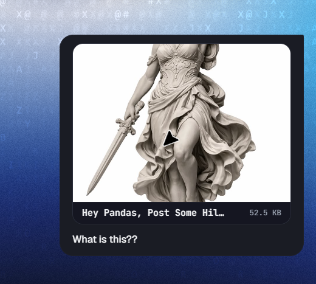
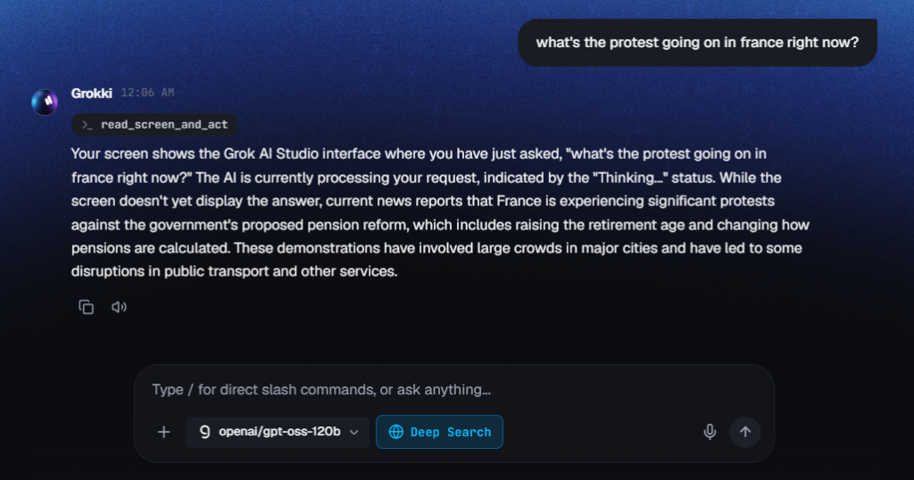
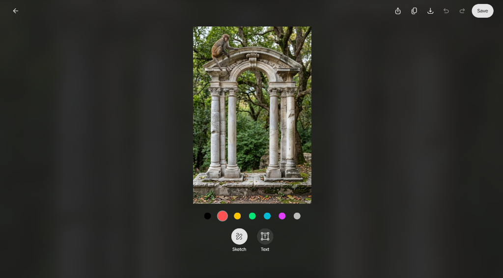
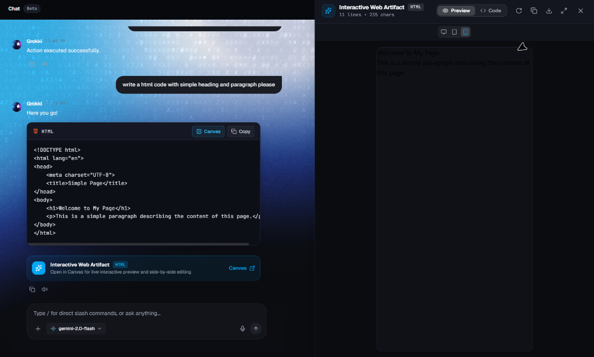

<div align="center">


[](https://github.com/lonewolfFSD/grokki-studio)
[](https://electronjs.org/)
[](https://react.dev/)
[](https://www.typescriptlang.org/)
[](https://tailwindcss.com/)
[](LICENSE)

**An autonomous AI desktop companion living in an Apple-style Dynamic Island at the top of your screen.**  
*Equipped with real-time desktop vision, physical OS mouse/keyboard control, 65+ native Windows tools, and hybrid local/cloud intelligence.*

[Key Features](#-key-features) • [Screenshots](#-preview--screenshots) • [AI Brain Engines](#-ai-brain--multi-engine-support) • [Tool Arsenal](#-complete-tool-arsenal-65-built-in-capabilities) • [Quick Start](#-quick-start) • [Installer Build](#-building-the-installer-exe) • [Contributing](#-contributing)

</div>

---

## 📸 Preview & Screenshots

<div align="center">
  <table>
    <tr>
      <td width="50%" align="center">
        
        <br/><b>⚡ Grokki Island with Real GPU Desktop Blur (`Alt+Q`)</b>
      </td>
      <td width="50%" align="center">
        
        <br/><b>🎛️ Grokki Studio Central Dashboard</b>
      </td>
    </tr>
    <tr>
      <td width="50%" align="center">
        
        <br/><b>🧠 Dual AI Brain (Paid Flagships & Free Engines)</b>
      </td>
      <td width="50%" align="center">
        
        <br/><b>💼 Google, Notion, Obsidian & GitHub Integrations</b>
      </td>
    </tr>
  </table>
  <sub><i>Tip: Drop your screenshots into <code>assets/screenshots/</code> to replace the fallback previews above.</i></sub>
</div>

---

## ⚡ Key Features

Unlike browser-based chatbots or static wrappers, Grokki is a **living Windows OS agent**. He perceives your monitor, makes autonomous decisions, and physically drives your computer.

### 1. 🪟 Genuine Desktop Blur (True Apple Glass)
Windows cannot natively blur third-party desktop windows behind transparent frameless Electron shells. Grokki solves this:
* On summon (`Alt + Q`), a GPU-accelerated capture pipeline snaps your desktop background.
* It applies a real-time Apple-spec Gaussian blur layer (`blur(38px) brightness(0.55) saturate(190%)`).
* Your wallpaper, active IDE, browser, and documents blur dynamically in real-time.
* Click anywhere outside the island to dismiss.

### 2. 🦾 Real OS Mouse & Keyboard Manipulation
* Grokki doesn't just animate a cursor—he moves the **actual Windows OS mouse cursor** with smooth easing trajectories.
* Executes real left-clicks, double-clicks, right-clicks, and native keystrokes into active applications (Notepad, Word, File Explorer, Terminal).

### 3. 👁️ Ultra-Low Token Multimodal Vision
* Captures active displays and downscales frames for vision models.
* **Cost per screen scan: ~250 tokens** via Gemini Flash Vision.
* Identifies login screens, reads error squiggles in VS Code, inspects YouTube tutorials, and diagnoses active windows.

### 4. 🎯 Autonomous Goal Execution & Dynamic Pivoting
* **Zero hardcoded branching**: Grokki formulates multi-step action plans dynamically.
* *Example:* Ask Grokki to *"Play The Weeknd on Spotify"*. Grokki checks if Spotify Desktop is installed. If absent, he pivots to Spotify Web. If logged out, he inspects your screen, halts, and suggests:
  > *"Spotify isn't logged in on your browser. Would you like to log in now, or should I switch to YouTube Music instead?"*

### 5. 📋 Highlight-to-Action ("Act on Whatever I Selected")
* Highlight any text or code in your browser, PDF, or editor, and press **`Alt + Q`**.
* Ask Grokki to *"Rewrite this"*, *"Fix bugs in this selection"*, or *"Summarize this"*.
* Grokki grabs the highlighted selection, transforms it with your active AI engine, and copies the clean result directly to your clipboard (or auto-replaces it in place).

### 6. 🖤 The Living Dynamic Island Companion
* **Interactive Physics**: Click and poke Grokki's obsidian sphere face to see him squash, wink, jump, and giggle.
* **Synthesized Audio**: Procedural Apple-style UI chimes and audio feedback generated via Web Audio API.

---

## 🧠 AI Brain & Multi-Engine Support

Grokki features an interface toggle between **Paid Enterprise Flagships** and **Free Tier / Open-Source Engines**:

| Tier | Supported Engines & Providers | Highlights |
| :--- | :--- | :--- |
| **👑 Paid Models** | • **Grok (xAI)** (`grok-2-1212`, `grok-2-vision`)<br/>• **ChatGPT (OpenAI)** (`gpt-4o`, `gpt-4o-mini`, `o1`, `o3-mini`)<br/>• **Google Gemini Pro** (`gemini-2.5-pro`, `gemini-1.5-pro`)<br/>• **DeepSeek Official** (`deepseek-chat`, `deepseek-reasoner`)<br/>• **Qwen (Alibaba DashScope)** (`qwen-max`, `qwen-plus`) | Direct official API gateways, maximum token limits, deep STEM & reasoning models. |
| **⚡ Free / Open-Source** | • **Google Gemini Free Tier** (`gemini-2.5-flash`, `gemini-2.0-flash`)<br/>• **Groq Cloud** (`llama-3.3-70b-versatile`, 500+ T/s)<br/>• **Ollama Local** (`llama3.2`, `deepseek-r1`, 100% offline air-gap)<br/>• **OpenRouter** (`openrouter/auto`, community free models)<br/>• **OmniRouter** (Unified open routing gateway) | 100% free operation, private local offline models, zero cost inference. |

---

## 🛠️ Complete Tool Arsenal (65+ Built-in Capabilities)

```
Grokki Desktop Agent
├── 🖥️ System & OS Controls
│   ├── Real mouse clicks, double-clicks, right-clicks, and smooth cursor gliding
│   ├── Window management (focus, minimize, maximize, snap, close)
│   ├── Native audio volume & screen brightness controls
│   ├── System power (sleep, restart, shutdown, cancel shutdown)
│   └── 1-Click Downloads & Desktop auto-organizer
│
├── 📝 Productivity & Developer Tools
│   ├── Highlight-to-Action: Rewrites, fixes, or summarizes selected text anywhere
│   ├── VS Code Bug Doctor: Live problem/syntax diagnosis with direct copy-paste fixes
│   ├── MS Word & Notepad autonomous document authoring
│   ├── Git CLI & GitHub GUI (status, commit, push, pull, branch, clone)
│   └── Multi-format document parser (PDF, DOCX, TXT, Markdown, CSV, JSON)
│
├── 🌐 Workspace Ecosystem
│   ├── Google Workspace: Gmail, Calendar, Drive, Docs, Sheets, Tasks, Classroom
│   ├── Notion Workspace: Pages, database creation, search, notes
│   ├── Obsidian Vault: Local note creation, bi-directional linking, vault search
│   └── WhatsApp Web Automation: Automated messaging and file dispatch
│
├── 🎵 Media & Streaming
│   ├── Spotify, YouTube Music, Apple Music, and Amazon Music playback
│   ├── Media hardware keys (Next, Prev, Play/Pause, Stop)
│   └── YouTube video search, playlist manager, and lecture summarizer
│
└── 🎓 Academic Study Engine
    ├── 1-Page Exam Cheat Sheet synthesizer
    ├── Probable Exam Questions & Model Answer generator
    ├── Feynman Technique (ELI5) concept explainer
    └── ArXiv research paper search and automatic PDF downloader
```

---

## 🚀 Quick Start

### Prerequisites
- **Operating System:** Windows 10 or Windows 11 (64-bit)
- **Node.js:** v18.0.0 or higher
- **Package Manager:** npm or yarn

### Installation

1. **Clone the repository:**
   ```bash
   git clone https://github.com/lonewolfFSD/grokki-studio.git
   cd grokki-studio
   ```

2. **Install dependencies:**
   ```bash
   npm install
   ```

3. **Launch in Development Mode:**
   ```bash
   npm run dev
   ```

4. **Summon Grokki:**
   - Press **`Alt + Q`** from any application.
   - Or say **`"Hey Grokki"`** to trigger the background wake word detector.

---

## 📦 Building the Installer (.exe)

Grokki packages into a standalone Windows installer wizard via `electron-builder`:

```bash
# Compile and package for production (NSIS installer)
npm run dist
```

The output setup installer will be generated in `release/`:
```
release/Grokki Studio-Setup-1.0.0.exe
```

---

## 🔒 Security & Privacy Architecture

- **Private Keys**: All API keys and workspace tokens are stored in the user's local `%APPDATA%\data\` directory. Keys are never shipped in pre-built executables or sent to third-party tracking servers.
- **Zero Remote Telemetry**: Runs strictly peer-to-peer between your PC and your chosen LLM endpoints.
- **Air-Gap Capability**: Switch to **Ollama Local** in the AI Brain for a completely offline assistant with no internet access required.

---

## 🤝 Contributing

Contributions are welcome! Whether you are adding a new OS tool, refining UI components, or improving model compatibility:

1. **Fork the Repository**
2. **Create a Feature Branch:**
   ```bash
   git checkout -b feature/amazing-feature
   ```
3. **Commit Your Changes:**
   ```bash
   git commit -m "feat: add amazing new desktop tool"
   ```
4. **Push to the Branch:**
   ```bash
   git push origin feature/amazing-feature
   ```
5. **Open a Pull Request**

Please ensure all TypeScript interfaces compile cleanly (`npm run build`) before opening a PR.

---

## 📄 License

Distributed under the **Grokki Studio Non-Commercial License**. Free for personal and educational use; commercial redistribution, monetization, or selling is strictly prohibited. See [`LICENSE`](LICENSE) for more information.

<div align="center">
  <sub>Built with ❤️ for autonomous desktop computing.</sub>
</div>
