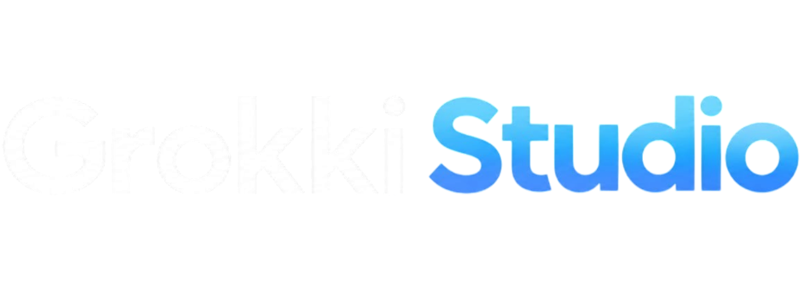
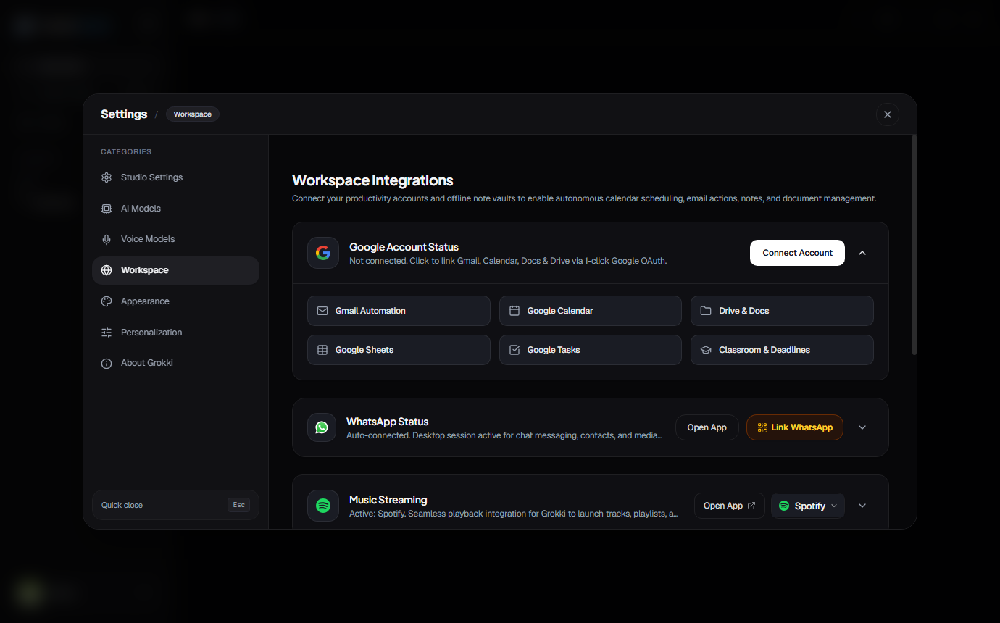

<div align="center">
  <br />
  <picture>
    <source media="(prefers-color-scheme: dark)" srcset="assets/grokki_wordmark.png">
    <source media="(prefers-color-scheme: light)" srcset="assets/grokki_wordmark_light.png">
    
  </picture>
  <p>
    
    
    
    
    
  </p>

  <h3>Autonomous AI desktop companion living in an Apple-style Dynamic Island & Top Notch.</h3>
  <p>Real-time desktop vision, physical OS mouse & keyboard automation, 70+ native Windows tools, and hybrid local/cloud intelligence.<br />Summoned instantly anywhere with <code>Alt+Q</code> or top-edge hover.</p>

  <p>
    <a href="#features"><strong>Features</strong></a> ·
    <a href="#screenshots"><strong>Screenshots</strong></a> ·
    <a href="#ai-brain-engines"><strong>AI Brains</strong></a> ·
    <a href="#desktop-tool-arsenal"><strong>Tool Arsenal</strong></a> ·
    <a href="#installation"><strong>Installation</strong></a> ·
    <a href="#packaging"><strong>Packaging</strong></a>
  </p>
  <br />
</div>

<p align="center">
  
</p>

<span></span>

## Overview

Grokki is an autonomous Windows desktop agent designed to live directly at the top of your screen inside a glass Dynamic Island and Top Notch. Rather than existing as an isolated browser chatbot, Grokki has direct physical agency over your operating system: he sees your displays with low-token vision, executes multi-step plans across native applications, and physically drives your mouse, keyboard, and background processes.

| Capability | Scope | What it does |
| :--- | ---: | :--- |
| **Native UI Automation** | Vercel agent-desktop | Zero-token accessibility tree snapshots, background clicking & typing with stable `@ref` IDs |
| **System & Desktop Agency** | 20+ tools | Mouse tracking, keyboard injection, audio, window management, screen capture, hardware power |
| **Hitodama Control Center** | Top Notch & Mobile | Zero-shadow capsule tabs: Controls, Today, Studio (Now-Playing Art), Apps, Games, Wallpaper, Themes, Clipboard, and Stats |
| **P2P Pocket Grokki Mobile** | Local LAN | Zero-cloud QR pairing, summon hopping, cross-device envelope file beam, attendance sync |
| **Workspace Integrations** | 25 tools | Google Workspace, Notion databases, local Obsidian vaults, GitHub CLI, and WhatsApp Gateway |
| **Productivity & Code** | 15 tools | Artifact sandbox canvas, VS Code bug diagnosis, file parsing, document authoring |
| **Media & Audio** | 12 tools | Spotify, YouTube Music, Apple Music controls, playlist search, lecture synthesis |
| **Games Hub** | Local Scan | Auto-discovers installed Steam/Epic/Xbox games with free cover art fetching |
| **Multi-Brain & Grounding** | 10 engines | Dual-battle comparative runs, consensus synthesis, live web grounding, local Ollama air-gap |
| **Voice & Speech Engine** | 4 providers | ElevenLabs, VoiceStudio, Edge TTS, and Grokki Voice with real-time waveform dynamic island |

---

## Features

### Vercel `agent-desktop` Native UI Automation Bridge
Grokki natively embeds Vercel's open-source `agent-desktop` engine for deterministic, token-free computer use:
* **Zero-Token Accessibility Snapshots**: Inspects the native Windows UI Automation (UIA) tree directly into structured JSON elements with scoped `@ref` IDs, bypassing vision models and saving hundreds of vision tokens per interaction.
* **Headless Background Operation**: Clicks buttons, switches tabs, and inputs values programmatically in the background without stealing active window focus or moving your physical mouse cursor. You can continue working while Grokki operates background apps!
* **Stale Reference Protection**: Real-time validation rejects outdated refs with `STALE_REF` if dialogs shift, preventing misclicks.
* **Hybrid Autopilot**: Leverages `agent-desktop` for instant, fast, zero-token UI control, falling back to Gemini Vision only for raw canvases, videos, and game graphics.

### Hitodama Top Notch Control Center
Access essential operating system controls instantly by hovering near the top notch or tapping the island:
* **Zero-Shadow Capsule Architecture**: Engineered with a strict zero-shadow, high-contrast frosted glass design system that dynamically follows your active theme palette.
* **9-Tab Unified Control Hub**:
  * **Controls**: Live OS volume bar capsule with percentage thumb, preset buttons (`25%`, `50%`, `75%`, `MAX`), and quick tiles (`Wi-Fi`, `Bluetooth`, `Audio Output`, `Night Light`, `Dark Mode`, `Speech to Text`).
  * **Today**: Agenda timeline, upcoming calendar appointments, and quick tasks.
  * **Studio**: Live Windows Media playback detection displaying album art covers, track title, artist, playback status badge, and transport controls.
  * **Apps**: Fast application launcher categorized by work, code, media, and tools.
  * **Games**: Installed PC games launcher with auto-fetched poster art.
  * **Wallpaper**: Instant dynamic wallpaper switcher with blur presets.
  * **Themes**: Live theme palette selector with instant desktop & mobile sync.
  * **Clipboard**: Persistent clipboard history with image thumbnail previews, direct one-click paste into active windows, pin/unpin toggles, and deletion.
  * **Stats**: Real-time hardware telemetry: CPU load %, processor model, RAM usage (`used / total GB`), and host system uptime.

### Peer-to-Peer Pocket Grokki Mobile (LAN Companion)
Bring your autonomous desktop assistant directly to your mobile phone over your local Wi-Fi without third-party servers, cloud relays, or exposed ports:
* **Hitodama Mobile Overhaul**: Pocket Grokki renders the full Hitodama Control Center right on your phone (`http://<LAN_IP>:8765`), equipped with `Plus Jakarta Sans`, `JetBrains Mono`, and FontAwesome 6 vector icons.
* **Zero-Cloud P2P LAN Pairing**: Pair your smartphone with your Windows PC in seconds using a dynamic cryptographic QR code or single-click local discovery. All communication is strictly local to your private network.
* **Cross-Device Summon Hopping**: Teleport Grokki seamlessly between your desktop screen and your mobile device. Summon Grokki directly onto your phone screen or shoot him back onto your Windows desktop Dynamic Island with fluid portal physics.
* **Animated Envelope File Transfer**: Drag and drop documents, images, or code on desktop into Grokki to package them into an animated envelope and beam them directly to your phone (and vice-versa) for instant offline download and opening.
* **Live Academic & ERP Attendance Tracking**: Auto-sync and view live university ERP records, course attendance percentages, and shortage warnings (`+N classes needed for 75%`) directly on mobile with session auto-recovery and zero credential exposure.
* **Remote Pocket Agency**: Ask questions, trigger desktop tools, manage playback, adjust master volume, and access clipboard sync on the move.

### Dynamic Theme Engine & Carousel
Personalize Grokki Studio, the Dynamic Island, Top Notch, and Pocket Grokki with synchronized theme palettes:
* **8 Curated Palettes**: `sunset`, `grokki-blue`, `cream`, `jungle`, `sakura`, `cyber`, `arctic`, and `crimson`.
* **Horizontal Theme Carousel**: Smooth horizontal drag-and-scroll selector in the Appearance settings.
* **Independent Light / Dark Mode**: Dedicated dual-mode support across all modals, search dialogs, and popover menus.
* **Instant Broadcast**: Switching themes in Grokki Studio broadcasts real-time color updates across the desktop overlay and connected mobile companions.

### Conversation Timeline & Sleek Recents Divider
* **Date-Segmented Recents**: Chat history is organized chronologically under `Today`, `Yesterday`, `Previous 7 Days`, and `Older`.
* **Sleek Visual Dividers**: Beautiful curved branch lines link individual conversation cards to their date clusters.
* **Fast Keyboard Search (`Ctrl+K`)**: Modal dialog with full-text search, keyboard navigation (`↑`/`↓` and `Enter`), and dual light/dark aesthetics.
* **Chat Management**: Pin favorite threads to the top, rename conversations inline, and delete old chats with zero clutter.

### AI Brain Switcher & Local Ollama Air-Gap
* **Local Ollama Verification**: Automatically inspects local Windows binary paths (`%LOCALAPPDATA%\Programs\Ollama`, `Program Files`, and `where.exe ollama`) as well as the active daemon endpoint (`127.0.0.1:11434`).
* **1-Click Download Button**: If Ollama is not installed, an actionable card with a direct download button is rendered automatically.
* **Daemon Launcher**: If Ollama is installed but stopped, start it directly from the UI with a single click.
* **Multi-Provider Switcher**: Effortlessly switch between free tiers (Gemini Free, Groq Cloud, OpenRouter) and flagship powerhouses (OpenAI, Claude, xAI Grok, DeepSeek).

### Multi-Brain Dual Battle & Consensus
* Dispatches any prompt concurrently to two separate AI brains (e.g. Gemini Flash vs. Groq Qwen/Llama or local Ollama).
* Comparative side-by-side card grid showing model name, individual latency in milliseconds, copy buttons, and winner selection.
* Interactive consensus engine cross-examines both model outputs, filters hallucinations, and synthesizes a unified verdict.

### Installed Games Hub & Poster Fetcher
* **Automatic Game Detection**: Automatically scans your Windows PC for installed games across Steam libraries, Epic Games Launcher, Xbox / Microsoft Store apps, and custom game directories.
* **Live Cover Artwork**: Fetches game posters and capsule art automatically from free game metadata APIs and caches them locally for fast, offline display.
* **1-Click Launch**: Launch any installed game directly from the Grokki Studio interface or Top Notch Games tab.

### High-Fidelity Voice Models
* **Multi-Voice Architecture**: Integrates ElevenLabs, local VoiceStudio servers, edge TTS, and Grokki Voice.
* **Custom Speed & Previews**: Adjust speech playback speed from `0.5x` to `2.0x` with instant audio preview testing.
* **Voice-to-Text Dynamic Island**: Floating speech-to-text capsule (`dictation_pill.html`) with live sound wave visuals and real-time transcription.

---

## AI Brain Engines

Grokki features a built-in provider switcher supporting both paid frontier flagships and free open-source engines:

| Tier | Provider | Recommended models | Highlights |
| :--- | :--- | :--- | :--- |
| **Paid flagships** | **OpenAI** | `gpt-4o`, `gpt-4o-mini`, `o3-mini` | Direct API gateway, maximum reasoning accuracy |
| | **xAI Grok** | `grok-2-1212`, `grok-2-vision` | High-speed frontier intelligence, vision capabilities |
| | **Google Gemini** | `gemini-2.5-pro`, `gemini-1.5-pro` | Million-token context window, deep document understanding |
| | **DeepSeek** | `deepseek-chat`, `deepseek-reasoner` | Specialized STEM and code reasoning architecture |
| | **Alibaba Qwen** | `qwen-max`, `qwen-plus` | Multilingual and mathematical problem solving |
| **Free / Open-Source** | **Groq Cloud** | `qwen/qwen3.8-27b`, `openai/gpt-oss-120b` | 500+ tokens/second inference speed on free API tier |
| | **Google Gemini Free** | `gemini-flash-latest`, `gemini-2.5-flash` | Free tier quota for vision and daily desktop tasks |
| | **Ollama Local** | `llama3.2`, `deepseek-r1` | 100% offline, air-gapped local inference with 1-click download |
| | **OpenRouter** | `openrouter/auto`, community free tier | Aggregated model catalog with automatic failover |
| | **OmniRoute** | `auto` | Universal unified local and remote model gateway |

---

## Desktop Tool Arsenal

```
Grokki Agent Runtime
├── Native Desktop UI Automation (vercel-labs/agent-desktop)
│   ├── Accessibility tree snapshots (`desktop_snapshot`) with scoped @ref IDs
│   ├── Deterministic background clicks (`desktop_click`) without mouse movement
│   ├── Headless text and value input (`desktop_type`)
│   ├── Instant element lookup (`desktop_find`) by role, name, or text
│   └── App and window lifecycle control (`desktop_app_control`)
│
├── Hitodama Control Center (Desktop Notch & Pocket Companion)
│   ├── Zero-shadow capsule tabs (Controls, Today, Studio, Apps, Games, Wallpaper, Themes, Clipboard, Stats)
│   ├── Real-time volume slider capsule with preset levels
│   ├── Live Windows Media now-playing album art & playback transport
│   ├── Persistent clipboard history with image thumbnail previews & 1-click paste
│   ├── System performance telemetry (CPU load, RAM used/total, Host uptime)
│   └── Safe Windows power controls (Lock, Sleep, Sign out, Restart, Shutdown)
│
├── Peer-to-Peer Mobile Ecosystem (Pocket Grokki)
│   ├── Dynamic QR-code device pairing & local encrypted LAN discovery (port 8765)
│   ├── Bidirectional device-to-device summon hopping (PC ⟷ Mobile)
│   ├── P2P Envelope File Beam & instant cross-device payload delivery
│   └── Mobile University ERP portal & attendance tracking
│
├── System & OS Controls
│   ├── Mouse tracking, double-clicks, right-clicks, and cursor easing trajectories
│   ├── Window management (focus, minimize, maximize, snap, close)
│   ├── Native audio volume, mute, and display brightness control
│   └── 1-Click Downloads and Desktop auto-organization
│
├── Developer & Productivity Tools
│   ├── Artifact Canvas: Live HTML/CSS/SVG sandbox preview and editor
│   ├── Highlight-to-Action: Rewrites, fixes, or summarizes selected text anywhere
│   ├── VS Code Bug Doctor: Live problem and syntax diagnosis with direct fixes
│   ├── Git CLI & GitHub GUI: status, commit, push, pull, branch, clone
│   └── Multi-format document parser: PDF, DOCX, TXT, Markdown, CSV, JSON
│
├── Games Hub
│   ├── Auto-discovery for Steam, Epic Games, Xbox, and local installs
│   ├── Free poster and cover artwork fetching & caching
│   └── 1-Click direct launcher
│
├── Workspace Ecosystem
│   ├── Google Workspace: Gmail, Calendar, Drive, Docs, Sheets, Tasks
│   ├── Notion Workspace: Pages, database creation, query, notes
│   ├── Obsidian Vault: Local note creation, bi-directional linking, search
│   └── WhatsApp Gateway: Self-hosted OpenWA API integration & background messaging
│
├── Media & Streaming
│   ├── Spotify, YouTube Music, Apple Music, and Amazon Music playback
│   ├── Media hardware keys (Next, Prev, Play/Pause, Stop)
│   └── YouTube video search, playlist manager, and lecture summarizer
│
└── Voice & Speech Synthesis
    ├── ElevenLabs neural speech engine
    ├── Local VoiceStudio server integration with health checking
    └── Edge TTS / Grokki Voice with adjustable speed & live preview
```

---

## Screenshots

<div align="center">
  <table>
    <tr>
      <td width="50%" align="center">
        
        <br/><sub><b>Grokki Studio Chat Workspace (Date-Grouped Recents, Floating Prompt & Tools)</b></sub>
      </td>
      <td width="50%" align="center">
        
        <br/><sub><b>Fast Search Dialog (<code>Ctrl+K</code> with Keyboard Navigation & Dual Theme)</b></sub>
      </td>
    </tr>
    <tr>
      <td width="50%" align="center">
        
        <br/><sub><b>Hitodama Top Notch Control Center (Controls, Studio, Clipboard, Stats & Power)</b></sub>
      </td>
      <td width="50%" align="center">
        
        <br/><sub><b>Dynamic Island Speech-to-Text & Sound Wave Capsule (<code>Ctrl+Space</code>)</b></sub>
      </td>
    </tr>
    <tr>
      <td width="50%" align="center">
        
        <br/><sub><b>Pocket Grokki Mobile Companion (Hitodama Mobile, Summon Hopping & P2P Beam)</b></sub>
      </td>
      <td width="50%" align="center">
        
        <br/><sub><b>AI Brain Multi-Provider Switcher (Ollama Local Air-Gap, Groq & Flagships)</b></sub>
      </td>
    </tr>
    <tr>
      <td width="50%" align="center">
        
        <br/><sub><b>Multi-Brain Dual-Battle Mode (Side-by-Side Latency Tracking & Consensus)</b></sub>
      </td>
      <td width="50%" align="center">
        
        <br/><sub><b>Appearance Engine (8-Theme Carousel & Synchronized Color Palettes)</b></sub>
      </td>
    </tr>
    <tr>
      <td width="50%" align="center">
        
        <br/><sub><b>Workspace Ecosystem (Google Workspace, Notion, Obsidian, GitHub & WhatsApp)</b></sub>
      </td>
      <td width="50%" align="center">
        
        <br/><sub><b>Voice Models Engine (ElevenLabs, VoiceStudio, Edge TTS & Speed Tuning)</b></sub>
      </td>
    </tr>
  </table>
</div>

---

## Installation

### Prerequisites
- **Operating System:** Windows 10 or Windows 11 (64-bit)
- **Node.js:** v18.0.0 or higher
- **Package Manager:** npm or yarn

### Setup

```bash
# Clone the repository
git clone https://github.com/lonewolfFSD/grokki-studio.git
cd grokki-studio

# Install dependencies
npm install

# Start in development mode with live HMR
npm run dev
```

### Summoning Grokki
- Press **`Alt + Q`** from any application to open the Dynamic Island.
- Hover your mouse at the top-center edge of your screen to drop down the **Hitodama Notch**.
- Press **`Ctrl + Space`** to trigger the floating Speech-to-Text dynamic island.
- Press **`Ctrl + K`** inside Grokki Studio to quickly search across past conversations.
- Press **`Ctrl + ,`** to open the Central Settings & Brain Switcher modal.
- Open **`http://<LAN_IP>:8765`** from your smartphone to launch **Pocket Grokki Mobile**.

---

## Packaging

Grokki packages into a standalone Windows installer wizard via `electron-builder`:

```bash
# Compile and build production installer (NSIS executable)
npm run dist
```

The output setup installer will be generated in `release/`:
```text
release/Grokki Studio-Setup-2.5.0.exe
```

---

## Security & Privacy

- **Local credentials**: All API keys, tokens, and workspace preferences are stored locally in `%APPDATA%\data\jarvis-config.json`. Keys are never bundled into executables or sent to telemetry servers.
- **Zero remote telemetry**: Execution runs strictly between your local machine and your configured AI endpoints.
- **Air-gap mode**: Select **Ollama Local** in the AI Brain tab to run completely offline without internet connectivity.

---

## Contributing

Contributions are welcome. Please read the following steps before submitting code:

1. Fork the repository.
2. Create your feature branch (`git checkout -b feature/amazing-feature`).
3. Verify that the TypeScript codebase builds cleanly (`npm run build`).
4. Commit your changes (`git commit -m "feat: add amazing feature"`).
5. Push to the branch (`git push origin feature/amazing-feature`).
6. Open a Pull Request.

---

## License

Distributed under the **Grokki Studio Non-Commercial License**. Free for personal and educational use; commercial redistribution, monetization, or selling is prohibited. See [`LICENSE`](LICENSE), [`PRIVACY_POLICY.md`](PRIVACY_POLICY.md), and [`TERMS_OF_USE.md`](TERMS_OF_USE.md) for details.

<div align="center">
  <sub>Built for autonomous desktop computing on Windows.</sub>
</div>
